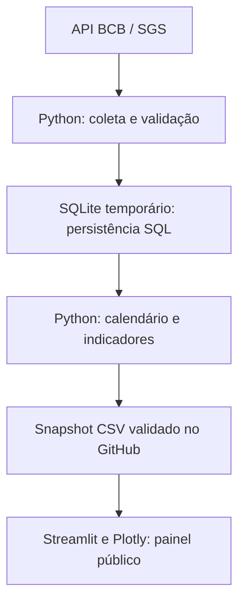

# Tecnologias e arquitetura do projeto

## O que está implementado

| Tecnologia | Papel no projeto | Situação |
|---|---|---|
| Python | Coleta do Bacen, validação, cálculos, exportação, testes e aplicação web | Implementado |
| Pandas / NumPy | Séries temporais, calendário mensal e indicadores econômicos | Implementado |
| SQL | Modelo relacional, persistência, revisões, qualidade e consultas analíticas | Implementado |
| SQLite | Banco padrão local e banco temporário de cada atualização diária | Em uso |
| PostgreSQL | Alternativa de banco para o pipeline; integração verificada na CI | Suportado e testado; não é o banco do site público |
| SQLAlchemy / psycopg | Conexão e execução de SQL; driver PostgreSQL | Implementado |
| Streamlit / Plotly | Páginas, filtros, tabelas, gráficos e download de CSV | Interface publicada |
| GitHub Actions | Atualização diária e verificação automática do código | Em uso |
| Power BI | Não há relatório, modelo semântico ou medidas DAX implementados | Não utilizado |
| Tableau | CSVs reconciliados e roteiro para montar um painel | Preparação de dados; sem workbook publicado |

## Fluxo da versão publicada



O GitHub Actions executa `scripts/update_data.py` diariamente às 19h17 de Brasília. Cada execução cria um banco próprio em `work/collection-*/collection.db`, reconsulta o histórico e publica somente uma base que passe pelas validações das 24 séries. Esse banco é temporário no runner; não é um banco PostgreSQL hospedado nem uma base SQL consultada pelo visitante.

O site lê `data/processed/latest.json` e os CSVs do snapshot indicado. `observatorio/snapshot.py` valida essa leitura; `dashboard/app.py` mantém os dados em cache. Abrir uma página ou mudar um filtro não faz nova chamada ao Bacen nem consulta SQL. A data de coleta não é a data de referência de todos os indicadores: cada série tem sua própria defasagem.

## Onde Python é usado

| Arquivo | Responsabilidade |
|---|---|
| `observatorio/client.py` | Requisições HTTP, timeout, tentativas limitadas e preservação das respostas |
| `observatorio/transform.py` | Parsing, tratamento de ausências, calendário mensal, variações, valores reais e base 100 |
| `observatorio/quality.py` | Verificações da qualidade das séries |
| `observatorio/db.py` | Conexões, SQL parametrizado, upsert e bloqueio de concorrência |
| `observatorio/pipeline.py` | Orquestração da coleta, persistência e geração dos arquivos analíticos |
| `observatorio/analysis.py` | Análises, correlações e relatórios |
| `observatorio/snapshot.py` | Validação da integridade dos arquivos consumidos pela interface |
| `dashboard/app.py` | Navegação, filtros, gráficos Plotly, tabelas e exportação |
| `scripts/update_data.py` | Atualização isolada e promoção da base validada |
| `tests/` | Testes de comportamento, regressão e integração |

Os indicadores do painel são calculados em Python e gravados no snapshot. A view SQL `v_monthly_changes` oferece consultas de variação e média móvel, mas não é a fonte dos cálculos exibidos no painel. As regras econômicas estão em [metodologia](metodologia.md).

## Onde SQL é usado

`sql/schema.sql` define sete tabelas:

| Tabela | Conteúdo |
|---|---|
| `series` | Catálogo de séries, unidades e metadados |
| `runs` | Execuções, status e resumo da coleta |
| `observations` | Valores originais, com chave única por série e data |
| `monthly_observations` | Grade mensal, incluindo lacunas explícitas |
| `derived_indicators` | Indicadores calculados em Python, identificados por série, data e métrica |
| `revisions` | Alterações detectadas em valores já armazenados |
| `quality` | Verificações e mensagens de qualidade por execução |

`observatorio/db.py` executa consultas com parâmetros, transações e `INSERT ... ON CONFLICT` para atualizar valores sem duplicar a chave. `observatorio/pipeline.py` grava as tabelas mensais e derivadas e consulta qualidade, últimos valores e cobertura para gerar os CSVs.

`sql/views.sql` contém:

- `v_latest`: último valor mensal não nulo por série, usando `ROW_NUMBER`.
- `v_coverage`: início, fim, meses observados e ausentes, com `LEFT JOIN` e agregações.
- `v_monthly_changes`: variações e média móvel com CTE, `LAG` e funções de janela; divisões usam `NULLIF` para evitar denominador zero.

No projeto local completo, `sql/analysis.sql` reúne consultas adicionais de comparação PF/PJ, crescimento do crédito e defasagem das séries. Esse arquivo é auxiliar e não faz parte do pacote reduzido publicado.

### Exemplos de consultas somente de leitura

Execute em um banco já populado pelo pipeline, usando um cliente SQLite ou PostgreSQL:

```sql
-- Última referência disponível por série
SELECT code, name, date, value, unit
FROM v_latest
ORDER BY code;

-- Cobertura e lacunas
SELECT code, name, first_date, last_date, observed_months, missing_months
FROM v_coverage
ORDER BY code;

-- Crescimento nominal do saldo total de crédito
SELECT date, value, mom_pct, yoy_pct
FROM v_monthly_changes
WHERE code = 20539
ORDER BY date;
```

No fluxo local completo, `DATABASE_URL` seleciona SQLite ou PostgreSQL; o padrão é `data/observatorio.db`. No job diário, `scripts/update_data.py` escolhe explicitamente seu SQLite isolado. `TEST_DATABASE_URL` é exclusivo do banco descartável de integração.

O histórico de revisões é acumulado quando se reutiliza o banco local. O job diário cria um banco novo: sua tabela `revisions` não constitui um histórico persistente entre dias. As versões dos snapshots publicados ficam no histórico do Git.

## Power BI e Tableau: limite do escopo atual

**Power BI não faz parte da implementação atual.** Não existem arquivos `.pbix`, `.pbit` ou `.pbip`, medidas DAX, transformação em Power Query ou atualização agendada de um relatório Power BI. Não seria correto apresentar este projeto como um dashboard desenvolvido em Power BI.

Os CSVs poderiam servir de entrada para uma implementação futura em Power BI, mas isso exigiria construir e validar o modelo e o relatório. A atualização diária do GitHub não configura, por si só, a atualização de um relatório Power BI.

Para essa futura integração, o contrato dos dados já permite definir cuidados:

- `analytics.csv` tem uma linha por série (`code`) e mês (`date`), dentro de um `snapshot_id`.
- `catalog.csv` contém metadados; deve ter chave única `code` para uma relação de um para muitos com a tabela analítica.
- `quality.csv` tem várias verificações por série: uma junção direta pode multiplicar os valores. Mantenha uma tabela separada.
- Não some taxas no tempo, nem o total de crédito com seus componentes PF/PJ. Preserve unidades e bases dos valores reais.
- Não misture snapshots; valide os valores contra o explorador do Streamlit antes de publicar outro painel.

O pipeline também gera cópias dos CSVs em `exports/tableau/<snapshot_id>/` e confere seus hashes. Essa exportação é uma preparação para BI, não um painel Tableau pronto. No job diário, ela fica dentro do diretório temporário; a publicação no GitHub seleciona os arquivos de `data/processed`. O roteiro Tableau completo pertence à documentação local.

## Como descrever o projeto

Descrição fiel ao que foi implementado:

> Pipeline de dados econômicos do Banco Central desenvolvido em Python e SQL, com validação de dados, persistência em SQLite, suporte a PostgreSQL testado em CI, indicadores em Pandas e dashboard interativo em Streamlit/Plotly. Coleta e publicação automatizadas com GitHub Actions, incluindo exportações CSV para ferramentas de BI.

A documentação distingue suporte técnico, testes e uso em produção. Power BI não deve ser incluído entre as tecnologias utilizadas até existir uma implementação validada.
